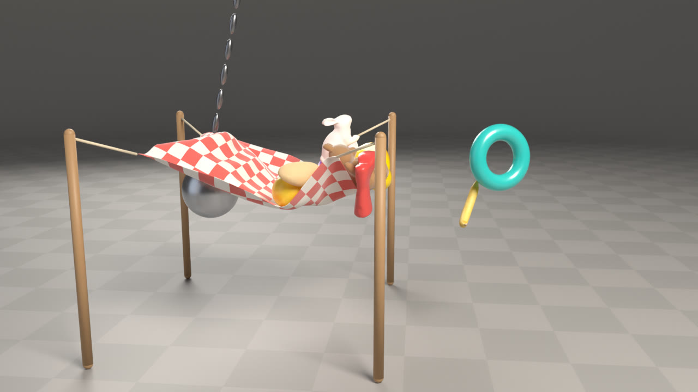

# Showcase: toys, a hammock and a wrecking ball

A larger scene for the variational deformable solvers
(`src/BulletSoftBody/BulletVariationalDeformable`), made to be simulated offline and rendered with
Blender.

- A gingham cloth is tied by its corners between four posts and sags into a hammock. It is a
  mass-spring system (Liu et al. 2013) of 44 x 44 nodes.
- Nine soft toys drop into it one after another: a teddy bear, a rubber duck, a bunny, a banana, a
  boot, a loaf of bread, two tori and a ball. They are Stable Neo-Hookean solids (Smith et al. 2018)
  of different stiffness.
- A wrecking ball of almost 50 kg hangs on a chain of thirteen links. The links are joined by hard
  attachments, which the augmented Lagrangian of Augmented VBD (Giles et al. 2025) keeps closed
  under that load: the joint error is typically 0.1 mm and stays near 1 mm at its worst. The ball
  is held back at first, then released, and swings into the loaded hammock.
- Everything touches through the barrier contact of Incremental Potential Contact (Li et al. 2020)
  with friction: cloth against toys, toys against each other, the cloth against itself, the chain
  against the cloth, all of them against the posts and the floor. Every step is kept free of
  intersections by continuous collision detection, and the independent check that the scene runs
  once per simulated second found none.

The solver is `btVariationalHybrid`: about 6600 nodes, a time step of 1/120 s, and on average 1.6
seconds of computation per step on one core (5 seconds for the hardest steps).

## Geometry

The tori, the ball, the chain links and the wrecking ball are generated
(`btVariationalHelpers::createTetTorus`, `createTetEllipsoid`). The organic shapes come from
Bullet's `data` folder:

| Toy | Simulated volume | Rendered surface |
|-----|------------------|------------------|
| teddy | `teddy.vtk`, 583 nodes | `teddy.obj`, 1598 vertices |
| duck | `duck.vtk`, 543 nodes | `duck.obj`, 2108 vertices, with `duckCM.png` |
| bunny | `bunny.vtk`, 391 nodes | `bunny.obj`, 453 vertices |
| banana | `banana.vtk`, 725 nodes | `banana.obj`, 552 vertices, with `banana.png` |
| boot, bread | `boot.vtk`, `bread.vtk`, about 600 nodes each | the boundary of the volume |

`teddy.vtk`, `duck.vtk` and `bunny.vtk` are new. `make_tet_mesh.py` made them from the surface
models of the same names with fTetWild: coarse tetrahedra of good shape (the worst element has a
quality of 0.17, where 1 is a regular tetrahedron) whose boundary follows the surface model within
0.6 % of its size. The detailed surface is not simulated. `VariationalMeshExport.h` ties every vertex
of it to the tetrahedron it lies in and moves it along, so the picture shows the fine surface while
the solver works on a few hundred nodes per toy.

(The tetrahedral bunny that Bullet's `SoftDemo` uses is not suitable for an implicit solver: it
contains elements that are flat to within 1e-7 of their size, which makes the linear systems
practically singular.)

## Reproducing the video

    # 1. simulate: writes scene.json and frames.bin (60 frames per second) into the output folder
    mkdir out
    App_VariationalShowcase out 9.2 /path/to/bullet3/data

    # 2. render with Blender's Cycles, here through the Python module (pip install bpy)
    python render_showcase.py out frames --data /path/to/bullet3/data --end 8.8 --samples 20

    # 3. encode
    ffmpeg -framerate 30 -i frames/frame_%04d.png -c:v libx264 -crf 17 -pix_fmt yuv420p showcase.mp4

`App_VariationalShowcase` is built by CMake with the examples (it is not part of the example
browser: the scene is far from real time). The simulation takes about half an hour on one core; a
coarser cloth (a fifth argument of 2 and a sixth of 28) makes it about a third faster for previews.
The comment at the top of `render_showcase.py` lists the options of the renderer (resolution,
samples, time range, a fixed camera instead of the animated one, single stills). On four CPU cores
a frame of 1280 x 720 with 20 samples takes about 20 seconds.

## Files

| File | |
|------|-|
| `VariationalShowcase.cpp` | the scene |
| `ShowcaseMain.cpp` | runs it without graphics |
| `VariationalMeshExport.h` | writes the surfaces frame by frame, with embedded render surfaces and texture coordinates |
| `render_showcase.py` | reads that output in Blender: materials, studio lighting, camera move, Cycles settings |
| `make_tet_mesh.py` | tetrahedralizes a closed OBJ surface into a VTK file (`pip install pytetwild pyvista`) |
